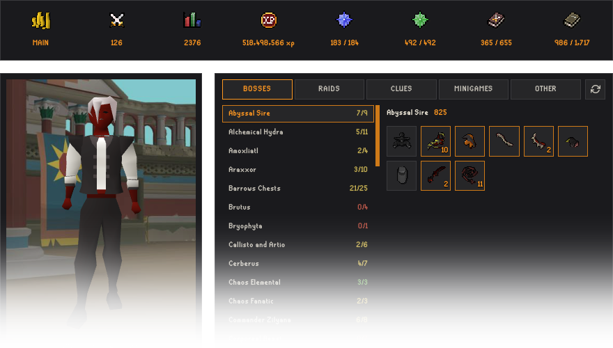
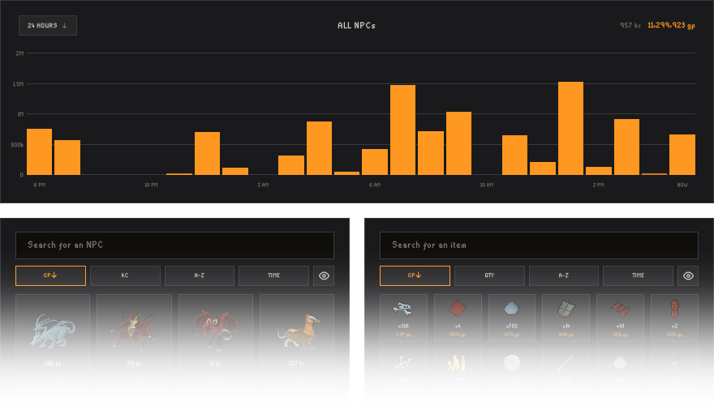
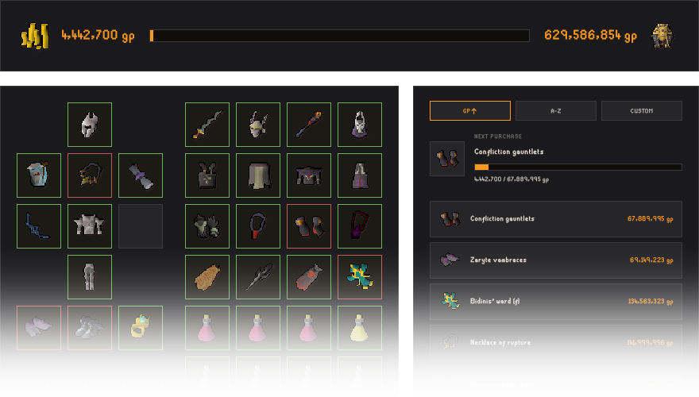
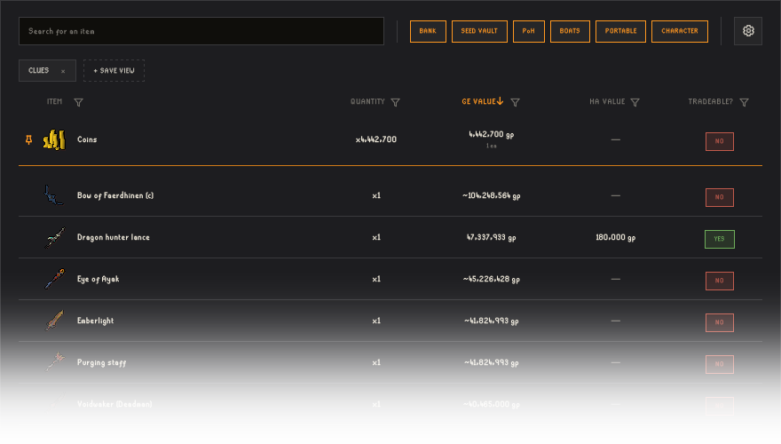
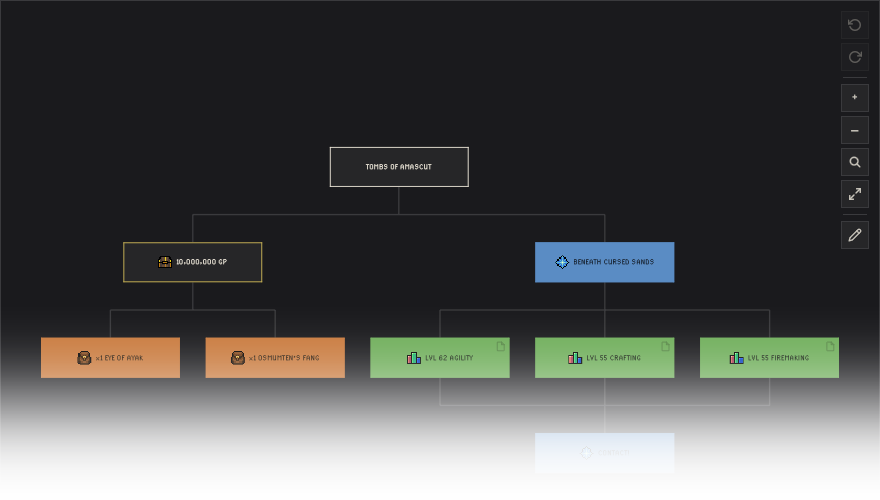

  

---

<a href="https://myscape.io">myscape.io</a> is your new favorite RuneLite plugin and OSRS companion site.

myscape is a free, open-source project that was created by an Old School RuneScape player who wanted more functionality than other plugins and websites offered. Comprised of a suite of apps to help you plan, track, and share your OSRS experience, myscape aims to be an integral part of how you play the game.

---

## Information

The myscape RuneLite plugin works in-tandem with the [myscape.io](https://myscape.io) site to allow for the apps below to work. The plugin sends the data to the site, allowing you to explore your OSRS character in ways you never have before.

## Apps

[Character Overview](https://myscape.io/c/mv7pu): An optionally shareable profile that shows your character's collection log data, skill levels, quest completions, achievement diary tiers, and combat task tiers.

[Loot Tracker](https://myscape.io/s/njnku7mnas): An enhanced, feature-rich improvement on loot tracking allowing for historical data, drill-downs, and searching.

[Purchase Goals](https://myscape.io/s/k3efa9ewsu): A sandboxed inventory and gear setup tracker, syncing your current bank's content against your desired purchases, with live Grand Exchange pricing.

[Storages Viewer](https://myscape.io/s/3fzrz7q5z2): A fully searchable, sortable, and filterable conglomeration of every one of your items, from every storage, across the game.

[Mindmaps](https://myscape.io/s/5dc8c49ncb): A feature-rich app that allows you to organize your goals and progress, complete with auto-detecting completion functionality.

[Goal Tracking](https://myscape.io/s/nysq229vq7): A personalized and customizable board for you to fill with your various goals for your character, complete with auto-detecting and updating progress bars.
